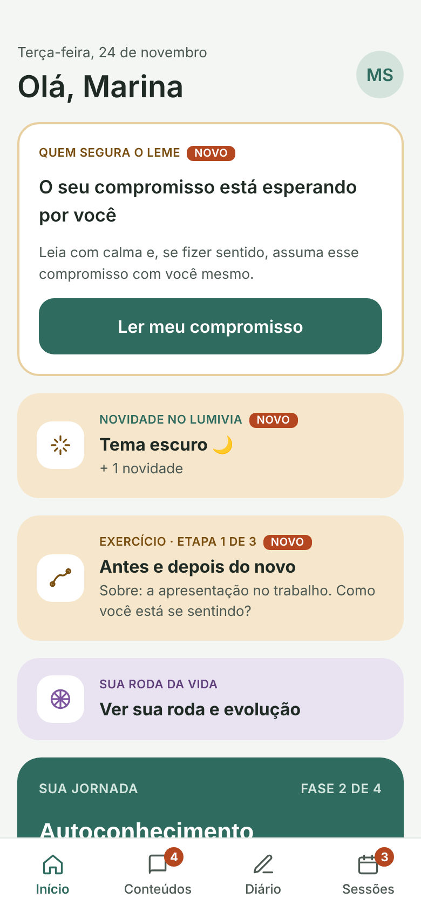
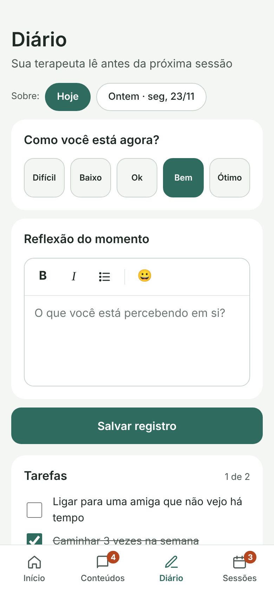
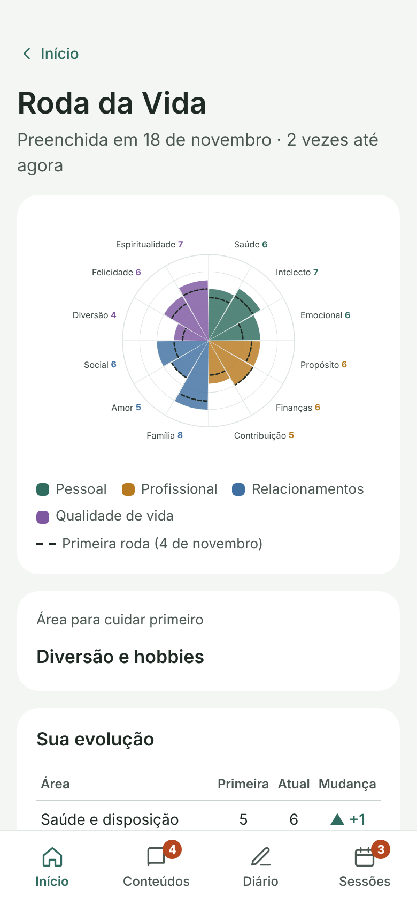
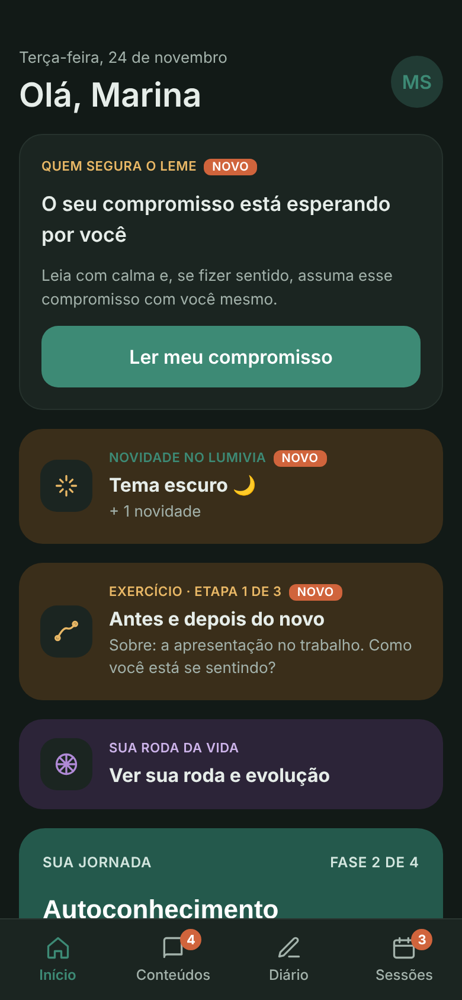
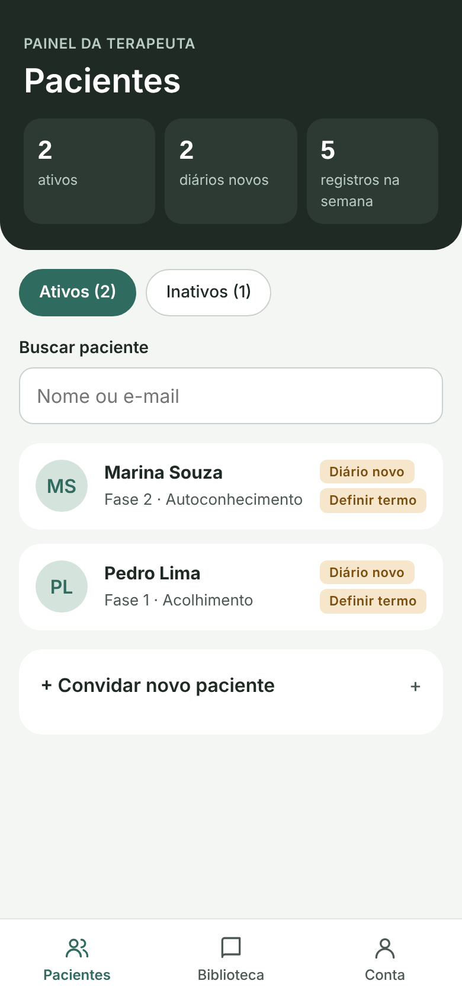
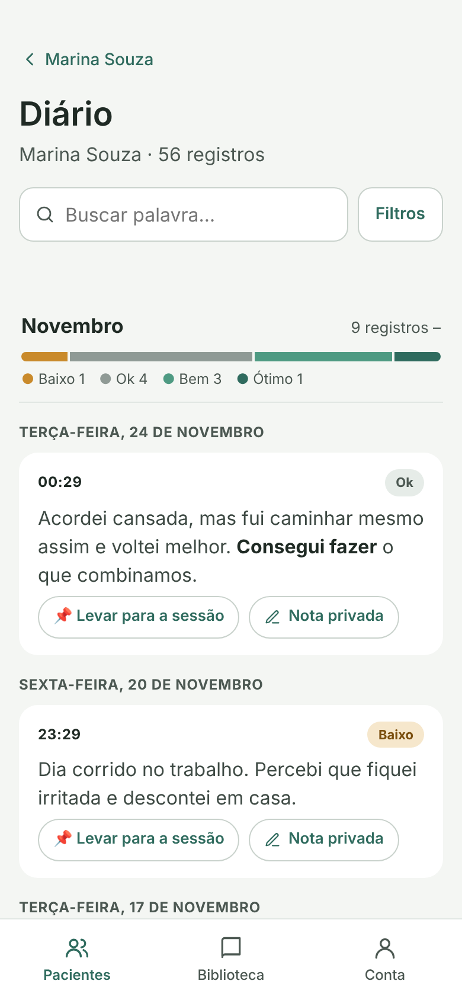
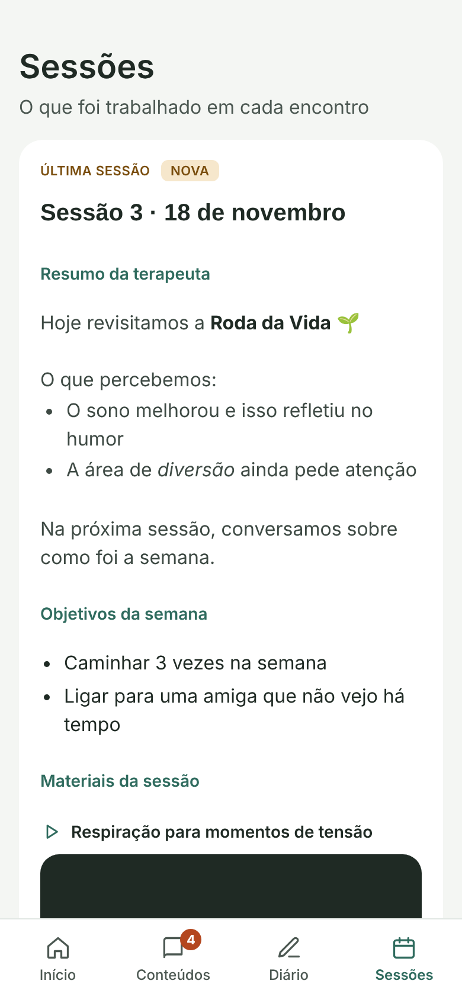
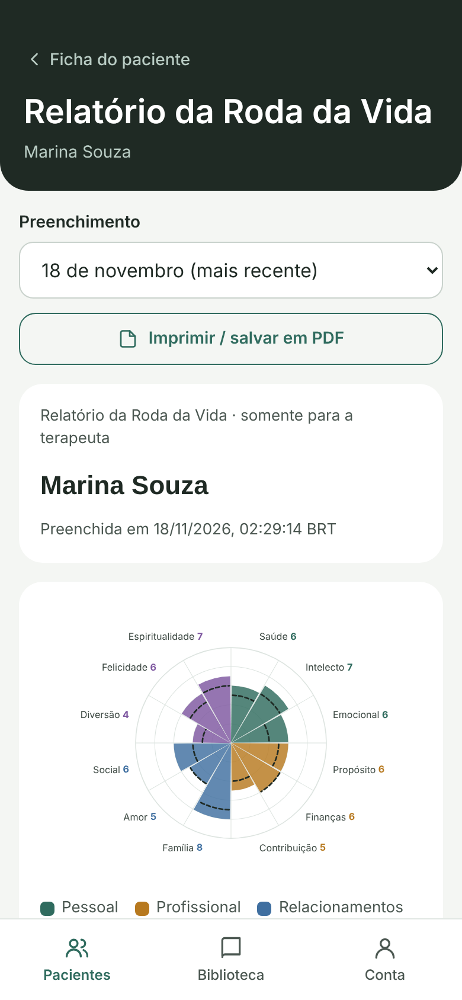
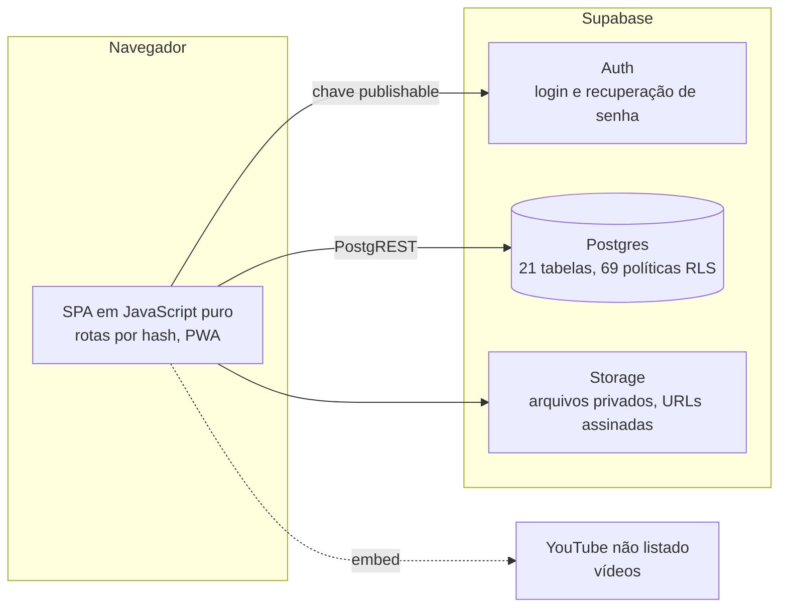

# Lumivia

**Plataforma de acompanhamento terapêutico: área do paciente e painel da terapeuta.**

Lumivia é uma aplicação web (PWA) que criei para a minha prática como terapeuta de desenvolvimento pessoal. Ela organiza o que acontece entre uma sessão e outra: diário emocional, conteúdos liberados por fase, registro das sessões, exercícios guiados e ferramentas como a Roda da Vida. Está em uso real, com pacientes.

🔗 **[Abrir a demonstração](https://lumivia-demo.pages.dev)**: dados fictícios, entre como paciente ou como terapeuta.

> O código-fonte é privado. Este repositório é uma vitrine do projeto. Acesso ao código para processos seletivos sob pedido: sara.developi@gmail.com

  
  
  
  

---

## O problema

Entre as sessões, o acompanhamento costuma se perder em mensagens soltas, arquivos espalhados e anotações em papel. O paciente não tem um lugar para registrar como está, e a terapeuta chega à sessão sem saber como foi a semana. As plataformas prontas eram caras, genéricas ou não tratavam com cuidado dados que, pela LGPD, são dados sensíveis de saúde.

## A solução

Um app único, que abre no celular como aplicativo, com duas visões:

**Paciente**
- **Diário** com humor obrigatório, vários registros por dia, editor com negrito, listas e emojis, e opção de registrar sobre o dia anterior.
- **Conteúdos** liberados por fase da jornada (vídeos, textos, exercícios, PDFs e áudios) ou individualmente.
- **Sessões**: resumo, objetivos da semana e materiais de cada encontro.
- **Roda da Vida** com histórico e comparação entre preenchimentos.
- **Exercícios guiados** em etapas, como o "Antes e depois do novo", para situações que geram ansiedade.
- **Compromisso consigo mesmo**, assumido uma única vez, com lembrete gentil nos dias difíceis.
- Gráfico de bem-estar, selo de "novo", novidades do app, tema claro/escuro e instalação como PWA.

**Terapeuta**
- Lista de pacientes com sinais de atenção (diário novo, termo pendente) e pacientes inativos separados.
- Ficha completa: fases, metas, tarefas, sessões com notas privadas, termos de acordo por paciente.
- Diário de cada paciente agrupado por mês, com busca, filtros, notas privadas e marcação "levar para a sessão".
- Relatório da Roda da Vida para imprimir ou salvar em PDF.
- Biblioteca de conteúdos e publicação de novidades para os pacientes.

  
  
  
  

## Arquitetura

| Camada | Escolha | Por quê |
| --- | --- | --- |
| Front-end | JavaScript puro, sem framework | App leve, sem etapa de build, fácil de manter sozinha |
| Back-end | Supabase (Postgres, Auth, Storage) | Regras de acesso no próprio banco, sem servidor para manter |
| Hospedagem | Cloudflare Pages | Gratuita, HTTPS, deploy a cada push |
| Vídeos | YouTube não listado | Não consome armazenamento do banco |
| Custo mensal | **R$ 0** | Planos gratuitos de todos os serviços |

## Segurança e LGPD

Diário e sessões são dados de saúde. A segurança não depende do front-end: está no banco.

- **Row Level Security em todas as tabelas.** O paciente só lê os próprios dados e só os conteúdos das fases liberadas para ele. A terapeuta lê tudo, mas não consegue editar o diário do paciente.
- **Notas privadas em tabela separada**, sem nenhuma política de leitura para pacientes.
- **Datas e versões definidas pelo servidor** (triggers e funções `security definer`): aceite de termos, exercícios e diário não aceitam datas vindas do navegador.
- **Regras de negócio no banco**: um compromisso só pode ser assumido uma vez; as etapas de um exercício só podem ser feitas em ordem; depois de aceito, o termo guarda uma cópia exata das condições.
- **Arquivos privados**, acessados por URLs assinadas e temporárias.
- **Nenhum HTML vindo do usuário**: o texto formatado é guardado como markdown simples e renderizado com escape.
- **Cadastro fechado**: só a terapeuta cria acessos; paciente inativo perde o acesso aos dados, mas o histórico é preservado.

## Qualidade

Venho de 4 anos como QA, e o projeto foi construído com a mesma disciplina:

- **Políticas RLS testadas** em um Postgres local com stubs do Auth do Supabase, simulando paciente A, paciente B e terapeuta em cada regra.
- **Testes de interface com Playwright** sobre um back-end simulado, cobrindo os fluxos principais nos dois perfis e nos dois temas.
- **Acessibilidade**: estados com `aria-pressed`, foco visível, textos alternativos, contraste revisado no tema escuro e layout pensado para celular.
- **Migrações versionadas** (14 até agora), sempre idempotentes, para evoluir o banco sem perder dados.

## Meu papel

Projeto individual. Fiz a concepção do produto a partir da minha prática clínica, o levantamento de requisitos, o design de cada tela, a modelagem das regras de acesso, os testes, a publicação e a evolução contínua. Várias funcionalidades, como o registro sobre o dia anterior e o tema escuro, nasceram de sugestões de pacientes.

**Stack:** JavaScript · HTML · CSS · Supabase · PostgreSQL · RLS · PWA · Playwright · Cloudflare Pages

## Próximos passos

- Exercício "Eu de antes, eu de agora", comparando duas semanas do diário.
- Lembretes por notificação.
- Exportação dos dados do paciente (portabilidade, LGPD).

---

© 2026 Sara Ingryd Alves Brito. Todos os direitos reservados. Veja [LICENSE](LICENSE).
